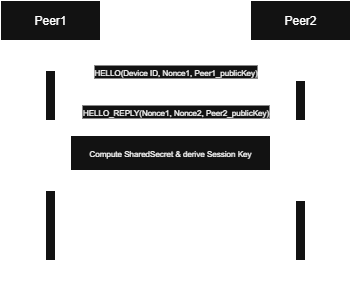

# Lightweight Secure Comms – Handshake Protocol

## Goal of the handshake

Establish a **shared session key** between client and server over TCP,
ensuring:

-   **Confidentiality**: Future messages are encrypted.
-   **Authenticity**: Both sides prove they hold the key.
-   **Replay Protection**: Nonces prevent reuse of old messages.

---

### Handshake Flow

#### Step 1: peer1 -> peer2 (HELLO)

```plaintext
[HEADER | DeviceID | Nonce1 | ESP_PublicKey]
```

-   DeviceID = unique identifier for client.
-   Nonce1 = random 128-bit number.
-   client_PublicKey = ECC public key for Diffie–Hellman.

#### Step 2: peer2 -> peer1 (HELLO_REPLY)

```plaintext
[HEADER | Nonce1 | Nonce2 | Laptop_PublicKey]
```

-   Echoes **Nonce1** (to prove it received Step 1).
-   Nonce2 = random 128-bit number from Laptop.
-   Laptop_PublicKey = ECC public key for Diffie–Hellman.

#### Step 3: Shared Secret Derivation

Both sides compute the same value:

```python
SharedSecret = DH(PrivateKey_self, PublicKey_other)
SessionKey = SHA256(SharedSecret || Nonce1 || Nonce2)
```

-   SessionKey derived from shared secret + nonces.
-   Prevents MitM replaying only the DH exchange.

#### Step 4: peer1 -> peer2 (CONFIRM)

```plaintext
[HEADER | Nonce2 | HMAC(SessionKey, “handshake_confirm”)]
```

-   Echoes **Nonce2** (to prove ESP saw Step 2).
-   HMAC = proof ESP has derived SessionKey.

#### Step 5: Laptop verifies & confirms

-   If HMAC is valid -> Handshake successful.
-   Both now store `SessionKey` for encryption.

### Security Properties

-   **Forward secrecy**: If ECC DH is used (e.g., `secp256r1`), session key is
    unique per handshake.
-   **Replay resistance**: Nonces ensure old handshakes can’t be reused.
-   **Integrity**: HMAC confirms both sides know the key.

### Transition to Secure Communication

After handshake, **all messages** are:

```plaintext
[HEADER | Ciphertext(AES/ChaCha20, SessionKey) | MAC]
```

-   Encrypted payload using SessionKey.
-   MAC (HMAC-SHA256) over ciphertext.

---

---

### ESP Client Main Loop Logic (Robust Handshake & Data Sending)

After initial WiFi connection, the ESP client:

1. Attempts to connect to the server via TCP.
2. Performs the handshake protocol (steps above) to establish a secure session
   key.
3. Once the handshake is complete and the session is secure, the ESP
   periodically (e.g., every 2 seconds) sends encrypted sensor data packets to
   the server.
4. If the TCP connection is lost (e.g., server restarts, WiFi drops), the ESP
   automatically:
    - Detects the disconnect,
    - Reconnects to the server,
    - Repeats the handshake,
    - Resumes periodic encrypted data sending.

This ensures handshake only happens once per connection, and data is only sent
when the session is secure. The main loop logic is robust to network
interruptions and will always attempt to restore a secure session before
resuming data transmission.

---

### Sequence Diagram


